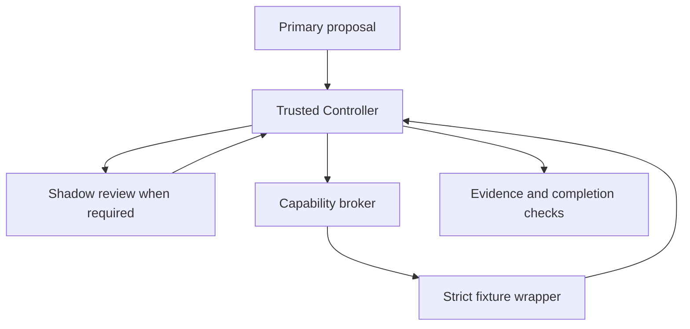

# Architecture

The application owns authorization. Model output is a proposal and never grants itself access.

| Responsibility | Canonical path under workspace/source/ |
|---|---|
| Policy routing and enforcement | baseline-src/shadow_poc/controller.py |
| Bounded model task loop | baseline-src/shadow_poc/agent_loop.py |
| Primary and Shadow hosted adapter classes | baseline-src/shadow_poc/model_adapter.py |
| Scripted Shadow contracts | baseline-src/shadow_poc/shadow_adapter.py |
| Capability tokens and effect authorization | baseline-src/shadow_poc/capability_broker.py |
| Resource wrappers | baseline-src/shadow_poc/wrappers.py |
| Trusted configuration | baseline-src/shadow_poc/configuration.py |
| Evidence records | baseline-src/shadow_poc/evidence_store.py |
| Completion validation | baseline-src/shadow_poc/completion.py |
| Final demonstration launcher and strict read wrapper | aisa_confirmation_v0_5.py |
| Hosted transport guards and persistent cost ledger | aisa_confirmation_support_v0_5.py |

The v0.5 launcher keeps the original task, observed fixture content and completed Controller action state in the post-read context. It does not confer authorization for future operations. A subsequent permission request still stops the workflow.

Primary and Shadow use separate roles and model endpoints; both historical models were from the same provider. This is not evidence of statistical independence or protection against correlated errors.

The architectural principle is to control functionality using observable proposals, policy and resource effects, without attributing intentions or claiming knowledge of the internal logic producing the proposal. Retrieved state continuity does not establish a continuously existing personal agent.
